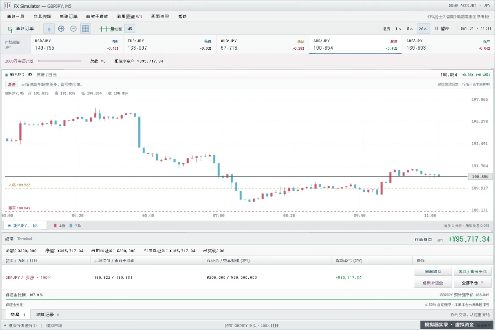
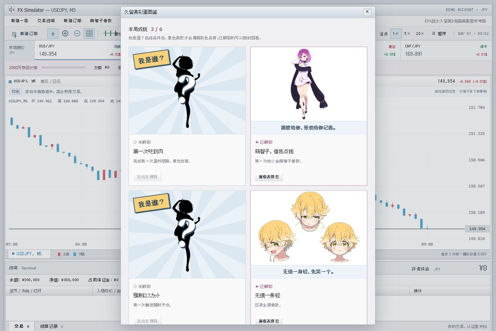

# FX 模拟器 · 久留美彩蛋版

本地运行的外汇小游戏，采用《FX战士久留美》电脑交易画面参考风格。初始本金 **¥300,000（30 万日元）**，余额、净值、保证金、盈亏与交易记录全部以 **JPY 日元** 计价。内部保留计算精度，界面金额最多显示两位小数。

现已加入角色借还款、六项成就、2000 万日元目标和「破产退场」结局，配有本地保存的久留美表情图。

**非官方同人游戏，仅使用虚拟资金和程序生成行情，用于娱乐与学习，不提供真实交易功能。**

## 开始玩

在 GitHub 仓库点击 **Code → Download ZIP**，解压整个文件夹。Windows 用户可双击 **启动游戏.bat**；其他系统用现代浏览器打开 **index.html**，不需要安装依赖。请保留 `assets/` 目录及其他源码文件，避免图表或表情图丢失。

可选：在这个文件夹运行 `npm start`，打开终端打印的本机网址。这个预览方式需要 Node.js 20+，无需 `npm install`；Ctrl+C 可停止服务。刷新页面会重新开始。

## 货币与风格

| 货币对 | 游戏风格 | 走势特点 | 初始模拟报价 | 模拟价差 |
| --- | --- | --- | ---: | ---: |
| USD/JPY 美元／日元 | 均衡 | 波动与趋势适中 | 150.000 | 0.020 |
| EUR/JPY 欧元／日元 | 稳健 | 波动较小、趋势较缓 | 163.000 | 0.030 |
| AUD/JPY 澳元／日元 | 活跃 | 波动较大、偶有快速变化 | 98.000 | 0.025 |
| GBP/JPY 英镑／日元 | 激进 | 波动和跳变更多 | 190.000 | 0.045 |
| CHF/JPY 瑞郎／日元 | 保守 | 小幅震荡为主、跳变较少 | 170.000 | 0.025 |

以上是**游戏设定**，不是实时汇率、历史行情或对真实货币风险的判断。所有报价都表示「1 单位该外币值多少日元」，各货币对独立模拟，未建立真实跨汇率关联。

## 价格与交易有没有关系？

**没有买卖反馈：下单、持仓方向、仓位大小、盈亏、平仓和强平都不会修改行情生成参数或消费市场随机数。**

价格采用「阶段切换＋随机波动＋偶发跳变」。每种货币独立在以下环境中切换，连续阶段不会使用同一种环境：

| 市场环境 | 持续时间（模拟分钟） | 特点 |
| --- | --- | --- |
| 横盘 | 16～40 | 波动较低，在本阶段开始时的局部参考价附近震荡 |
| 震荡 | 10～28 | 涨跌更反复，上一分钟的方向可能受到小幅反向修正 |
| 短趋势 | 8～24 | 随机偏涨或偏跌，趋势强度低于旧版，仍夹杂随机回撤 |
| 高波动 | 5～15 | 波动集中放大，跳变概率较高 |

阶段抽取的基础权重为25%/35%/25%/15%；抽中重复环境时改选其他环境，因此实际时间占比也受持续时间影响。横盘只围绕局部参考价，跨阶段会重新取参考价，不保证回到开局价格。各币种保留原有波动风格和固定点差；价格硬边界仍为1～1,000,000日元。图表每5分钟一根K线，保留最近180根。

前一时刻的价格与市场环境会影响下一步，玩家交易不会影响下一步。每种货币拥有独立的伪随机数序列，所有货币每个模拟步都前进，切换图表不会重置或暂停其他货币。

自动测试用相同种子分别运行交易账户和不交易账户，验证经过相同模拟步数后，五种货币的价格逐步完全一致；强平后的后续路径也一致。模拟器不会因为玩家买涨就故意下跌，或因为连续盈利就暗改难度。暂停、倍速和页面隐藏会改变模拟时钟的推进速度，重新开始则会生成新的一局行情。

## 操作

1. 点击顶部货币报价查看对应图表；可左右滚动手机上的报价栏。
2. 点击「新建订单」，在窗口内也可选择货币。输入**整数日元保证金**，选择 1/10/25/50/100 倍杠杆，然后买涨或买跌。
3. 同一时间最多持有一笔合并仓位，可在持仓处「同向加仓」；其他币种或反向交易须先平仓。持仓时可以查看其他货币，盈亏、加仓和平仓均使用原持仓币种的行情。
4. 在持仓旁「减仓 / 部分平仓」结算一部分，或点击「全部平仓」退出。下方「结算记录」显示币种、数量、释放保证金和日元盈亏，最近保留 200 条详情；结算次数和胜率按本局每次减仓、全平或强平分别统计。
5. 支持暂停、1/5/20 倍速、图表缩放、网格和十字线。每步 1 分钟，每根 K 线 5 分钟。红涨蓝跌；金额用绿盈红亏单独标记。
6. 暂停期间不能交易。打开帮助、参考和重置窗口或隐藏页面时，模拟时间休息，不追补积压。订单窗口中的行情持续推进，成交不会重置价格计时器。
7. 「新建一局」清空仓位、记录、欠款、本局成就和结局，恢复 30 万日元以及五种货币的初始报价。

## 同向加仓与补资金

持仓旁提供两个独立入口：

- **同向加仓**：输入追加的整数日元保证金，沿用原币种、方向和杠杆，确认时按最新 Ask（多头）或 Bid（空头）成交，合并外币数量、占用保证金、累计交易规模和入场均价。窗口持续报价，不会因为打开或成交而重启行情计时器。
- **借款补资金**：直接打开萌智子借款窗口，预览当前、借款后、还款后的余额、欠款和强平价。借还款不会改变仓位数量和均价。借款增加账户资金与欠款；原账户内闲置资金已经共同承担浮亏，无需再次“转进保证金”。

加仓均价按**外币数量加权**：每批数量×各自入场价之和，除以总数量。保证金和交易规模按各次投入累计；原开仓时间保留，每次结算记录标明此前加仓次数。每次加仓仍有新增价差成本，必须满足「追加保证金＋新增价差成本 ≤ 当前可用保证金」，已有浮亏也参与校验。

加仓窗口并排显示当前与预计加仓后的均价、外币数量、保证金、交易规模、强平价和保证金比例，并提示强平线是否更接近现价。**均价改善不等于更抗强平**：原浮亏不会消失，仓位增大后每单位价格变化的盈亏也更大。多单强平价降低、空单强平价升高，才表示其强平线远离当前价格；借款推远强平线的同时也增加欠款。

暂停期间不能加仓，仍可打开借款窗口补资金。持仓已平仓或强平后，加仓窗口会自动关闭；本局结局后仍遵守交易与借还款锁定规则。所有操作都不会影响市场随机序列。

## 减仓与部分平仓

持仓旁点击「减仓 / 部分平仓」，可选 25%、50%、75%、全部，或自填 **0.1%～100%（最多一位小数）**。比例针对**当前剩余仓位**，连续两次减仓 50% 后剩余原仓位的 25%。选择 100% 与直接「全部平仓」使用同一结算规则。

窗口持续显示最新平仓报价，并预览本次外币数量、结算盈亏、释放保证金，以及剩余仓位与账户的前后对比。多头按 Bid、空头按 Ask 平仓；确认时按最新报价成交。剩余均价、方向、币种、杠杆和最初开仓时间不变，之后仍可同向加仓。

**保证金释放只提高可用资金，不会再次计入余额。** 例如当前浮亏 10,000 日元，减仓一半将 5,000 日元亏损计入余额，另一半保留为浮亏；在相同报价下，账户净值保持不变。盈亏已经包含开平仓价差，不重复扣点差，不另收手续费，也不会自动用结算资金还债。

每次部分平仓独立记入「结算记录」，标明本次比例、数量、释放保证金和盈亏。胜率是盈利结算次数占全部结算次数的比例；首次盈利减仓也能触发「第一次吃到肉」。暂停或本局结束时不能减仓；仓位已被平仓或强平时窗口自动关闭。

## 盈利结算弹窗

首次盈利会在「第一次吃到肉」成就页同时标出**本次结算赚到的日元金额**，只弹一页。之后每次盈利减仓或全部平仓，默认弹出同样风格的结算页，显示当次金额、币种、方向、杠杆和结算方式。每次减仓只显示这次已平部分的盈利，不是整笔或累计收益；金额已包含点差，借款利息仍单独计入账户。极小的正收益若按两位小数会显示零，则标为`+<¥0.01`。

弹窗中可取消「每次盈利后显示结算弹窗」，也能在「帮助」重新开启。关闭后保留右下角结算消息，各项成就仍正常解锁，首次盈利成就仍每局显示一次。偏好保存在当前浏览器，刷新或新建一局后保持；浏览器禁止本地存储时仅当前页面内有效。盈利弹窗打开期间行情和计息休息。图鉴回看只展示成就，不会把上次盈利金额当成新收益。

## 角色借款与动漫彩蛋

点击菜单「萌智子借款」，向小金萌智子分次借款或还款，支持自填整数日元和快捷金额。「还清可还金额」可结清含小数尾数的欠款。未还本金最多2000万日元，待付利息另外记录；允许持仓时操作，还款不会挪用持仓所需资金，也不能超过欠款。

**游戏日息0.5%，按未还本金计单利。** 每1440个模拟分钟为一天，从借入后的下一分钟起逐分钟计提；累计满0.01日元从余额扣除，余数保留到后续分钟，借还款不清空计息余数。例如借100万，每模拟日利息5000日元；借2000万，每日利息10万日元。这是游戏参数，不是实际借贷利率。

余额不足的部分记为待付利息，会减少净值、可用保证金和扣债净资产；后续有余额时优先补缴。手动还款同样先付待付利息，再还本金，还本后下一分钟按较低本金计息。利息不并入本金，不产生复利。利息可能让保证金比例触及原有50%强平线。借款窗口显示累计计息、待付利息和当前每日利息。

计息只随模拟时钟推进；暂停、页面隐藏、帮助、借款窗口或图鉴打开时都不计息，不追补现实时间。倍速同步加快行情和计息。新建一局清空全部利息与欠款。

- 借款同时增加账户余额与欠款，还款同时减少两者，均不产生交易利润。
- **扣债净资产 = 账户净值 − 未还本金**，包含浮动盈亏并扣除待付利息，用于判断财富成就。
- **已实现 = 余额 − 未还本金 − 待付利息 − 初始30万**，已经扣除已付利息，避免把借款显示成盈利。每条交易记录仍只记录该次交易的结算盈亏，利息单独显示在借款窗口，不改变结算胜率口径。
- **本金借款额度用尽且平仓后资产耗尽**时触发原有「破产退场」结局。余额不足1日元按资产耗尽处理；还息产生本金小数尾数时，剩余可借额度不足1日元也按额度用尽处理。刚借到2000万不会直接结束游戏。
- 结局后行情、借还款和交易锁定，可查看记录、切换图表或重看结局，重新开局恢复正常。欠款未到上限时，本金见底仍可借款再试。

| 成就 | 触发条件 |
| --- | --- |
| 第一次吃到肉 | 第一次盈利结算，减仓也算 |
| 萌智子，借我点钱 | 第一次借款 |
| 强制ロスカット | 第一次自动强平 |
| 无债一身轻 | 还清全部借款 |
| 百万日元战士 | 扣债净资产达到100万 |
| 2000万，拿回来了！ | 扣债净资产达到2000万 |

每项成就每局只解锁一次。多个成就逐个弹出；破产结局优先显示，已解锁成就仍留在图鉴。六项成就各用不同配图，加入萌智子立绘、芽吹与安子的表情和游戏配字。

菜单「彩蛋图鉴」中，**未解锁图片显示黑色角色剪影、问号与「我是谁？」**，条件仍可查看；达成后才揭晓彩色表情并开放回看，不能提前点开原图。结局同样在本局达成后开放回看，并显示本局真实统计。回看不会改变资金、成就或进度；新建一局会重新隐藏全部图片。借款、图鉴和成就窗口会暂时休息行情，关闭后继续。达成2000万后可以继续交易。

角色借款对话、成就、结局与新增中文表情配字是为本游戏设计的同人玩法，不声称为原作逐段剧情复现。

## 日元交易规则

- 买入价 Ask = 中间价 + 半个价差；卖出价 Bid = 中间价 − 半个价差。各货币对价差见上表。
- **日元名义本金 = 保证金 × 杠杆。外币数量 = 日元名义本金 ÷ 实际入场价。** 例如 30,000 日元保证金、10 倍杠杆，对应 300,000 日元名义本金；若美元买入价 150.010，数量约为 1,999.87 美元。
- **日元盈亏 = 方向 × 外币数量 ×（实际退出价 − 实际入场价）**，多头方向 +1、空头 −1；不再把日元盈亏除以汇率换回美元。多头 Ask 开仓、Bid 平仓，空头相反。
- 开仓占用保证金但不从余额扣除。净值 = 余额 + 浮动盈亏 − 待付利息；可用保证金 = 净值 − 占用保证金。必须预留开仓价差成本。
- **保证金比例 = 净值 ÷ 占用保证金 × 100%；不高于 50% 时自动强平。** 本局其他本金也承担浮亏，损失可能超过本笔保证金。极端跳价后余额最低为零，记录按实际入账损益计算。
- 切换查看其他货币不会把持仓换到另一币种，也不会改变其强平价。只有查看持仓币种的图表时才画其入场／强平参考线。
- 估计强平价超出模拟价格范围1～1,000,000日元时显示无可达强平价。除上述借款单利外，不含额外交易手续费、滑点、持仓隔夜息或真实经纪商的执行细节。

## 界面来源与项目文件

参照了 [官方 PV 场景截图](https://moca-news.net/imgdisp.php?artid=202601191800a01&mode=A&seq=3) 和 [动画官网预告](https://fxkurumi-info.com/movie/)。斜视截图中无法辨认的菜单与完整订单窗按同样桌面风格补齐，并非逐像素复刻。主界面「画面参照」可查看来源。

- `engine.js`：货币配置、独立市场序列、日元账户、交易、强平、借还款与成就规则。
- `story-ui.js`：角色借款、成就图鉴、表情包弹窗与结局展示。
- `app.js`：货币报价栏、下单、持仓、计时和界面状态。
- `chart.js`：Canvas 图表与仓位参考线。
- `index.html` / `styles.css`：中文桌面风格交易台。
- `tests/`：日元盈亏、跨币种持仓、强平、行情独立性和本地服务验证。

表情图来源与文件对应见 [assets/SOURCES.md](assets/SOURCES.md)，原图版权行保留。图片均为本地资源，游戏运行不需要访问外部图片服务器。

角色、动画画面及第三方图片版权归各自权利人所有，不因源码公开而改变。借款对话、成就和结局为同人改编。

©でむにゃん・炭酸だいすき／KADOKAWA／「FX戦士くるみちゃん」製作委員会

运行 `npm test` 执行测试；`npm run check` 检查脚本语法。核心可用 `new FXEngine({ seed: 12345 })` 复现同一局行情，界面默认每局随机种子。

开发者可用 `node tests/browser-fixtures.cjs` 启动独立测试预览，访问打印地址的 `/ending-fixture`、`/wealth-fixture`、`/add-long-fixture`、`/add-short-fixture`、`/reduce-long-fixture`、`/reduce-short-fixture`、`/interest-fixture`、`/arrears-fixture` 或 `/small-profit-fixture`。测试页用真实借款、开仓、价格推进调用构造场景，用于核对结局冻结、重开、成就弹窗队列、多空加减仓以及跨日计息、欠息补缴与极小盈利显示；这些路由和脚本不在正常游戏服务器中提供。
